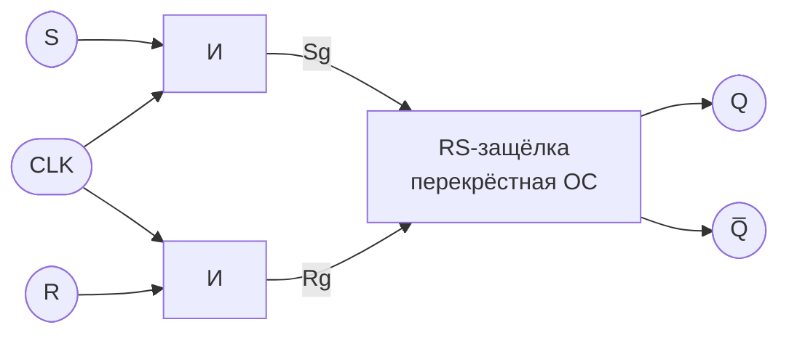
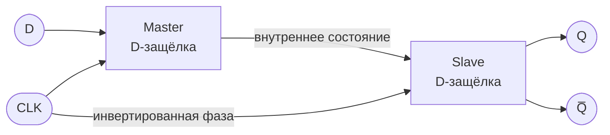
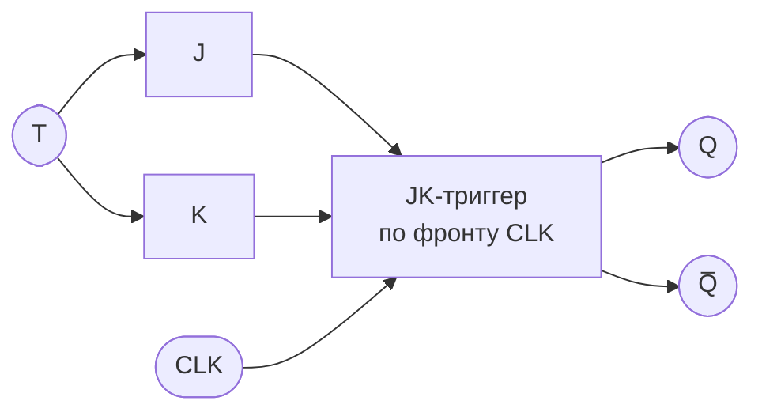
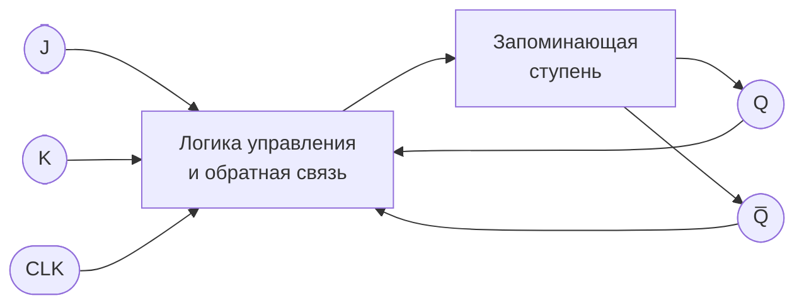
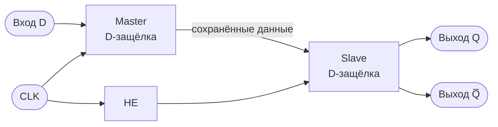

# Триггеры в цифровой электронике

> **Цель работы:** изучить назначение, таблицы истинности, характеристические уравнения и схемы синхронных RS-, D-, T- и JK-триггеров, а также принцип динамического тактирования.

## Содержание

1. [Основные понятия](#основные-понятия)
2. [Синхронный RS-триггер](#1-синхронный-rs-триггер)
3. [Двухступенчатый D-триггер](#2-двухступенчатый-d-триггер)
4. [Синхронный T-триггер](#3-синхронный-t-триггер)
5. [JK-триггер](#4-jk-триггер)
6. [Синхронный триггер с динамическим тактированием](#5-синхронный-триггер-с-динамическим-тактированием)
7. [Сравнение триггеров](#сравнение-триггеров)
8. [Источники](#источники)

---

## Основные понятия

**Триггер** — цифровое устройство с двумя устойчивыми состояниями, предназначенное для хранения одного бита информации. Его выходы обычно обозначают `Q` и `Q̅`; они являются инверсными друг к другу в нормальном режиме.

- `Q` — текущее состояние триггера.
- `Q⁺` или `Q(t+1)` — состояние после управляющего события.
- `CLK` — тактовый вход.
- `↑CLK` — положительный фронт тактового сигнала (переход `0 → 1`).
- `↓CLK` — отрицательный фронт (переход `1 → 0`).
- Черта над переменной означает логическое НЕ: `¬Q`.
- `X` в таблицах означает «неважно» или «любое значение».

**Синхронный триггер** изменяет состояние в соответствии с входами только в момент, определяемый тактовым сигналом. Важно различать **синхронное управление по уровню** и **динамическое управление по фронту**: у первого входы могут влиять на состояние в течение активного уровня такта, у второго состояние считывается при переходе тактового сигнала.

В схемах ниже используются стандартные логические элементы: `И` (AND), `ИЛИ` (OR), `НЕ` (NOT), а также перекрёстная обратная связь. Схемы выполнены в Mermaid — GitHub отображает такой синтаксис в Markdown. Если конкретный просмотрщик Mermaid не поддерживает, таблицы и формулы остаются доступными.

---

## 1. Синхронный RS-триггер

### Определение и принцип работы

**Синхронный RS-триггер** (Set–Reset) — запоминающее устройство с входами `S` (установка) и `R` (сброс), у которого изменение состояния разрешается тактовым сигналом `CLK`. При `CLK = 0` состояние сохраняется; при активном `CLK = 1` входы `S` и `R` управляют состоянием. Здесь рассматривается вариант, построенный на элементах И и RS-защёлке с активными высокими уровнями.

- `S = 1, R = 0` — установить `Q = 1`.
- `S = 0, R = 1` — сбросить, то есть установить `Q = 0`.
- `S = 0, R = 0` — сохранить прежнее состояние.
- `S = 1, R = 1` при активном такте — **запрещённая комбинация** для классического RS-варианта.

### Таблица истинности

Таблица приведена для активного высокого уровня такта. `Q` — состояние до управляющего воздействия, `Q⁺` — после него.

| CLK | S | R | Q⁺ | Режим |
|:---:|:---:|:---:|:---:|---|
| 0 | X | X | Q | Хранение |
| 1 | 0 | 0 | Q | Хранение |
| 1 | 0 | 1 | 0 | Сброс |
| 1 | 1 | 0 | 1 | Установка |
| 1 | 1 | 1 | — | Запрещено |

### Характеристическое уравнение

Для разрешённых комбинаций:

\[
Q^{+} = S + \overline{R}\,Q
\]

Уравнение следует применять с учётом запрета `S = R = 1`. При `CLK = 0` выход удерживается независимо от `S` и `R`.

### Структурная схема

Здесь `Sg = S · CLK`, `Rg = R · CLK`; тактовый сигнал пропускает входные команды только при `CLK = 1`. RS-защёлка обеспечивает хранение состояния за счёт обратной связи.

**Применение:** простые узлы хранения состояния, схемы управления, фиксация событий. Следует избегать одновременной активизации `S` и `R`.

---

## 2. Двухступенчатый D-триггер

### Определение и принцип работы

**D-триггер** (Data/Delay) хранит один бит и передаёт значение входа `D` на выход `Q` при управляющем событии. **Двухступенчатый D-триггер**, также называемый схемой *Master–Slave* («ведущий–ведомый»), состоит из двух последовательно соединённых D-защёлок:

1. **Master (ведущая)** получает данные `D`, пока открыт её тактовый уровень.
2. **Slave (ведомая)** закрыта на этом уровне.
3. При смене фазы такта Master закрывается, а Slave открывается и передаёт сохранённое значение на выход.

При схеме, где Master активен при `CLK = 1`, а Slave — при `CLK = 0`, выход обновляется на **отрицательном фронте** `↓CLK`. Если поменять фазы защёлок местами, можно получить срабатывание по положительному фронту.

### Таблица истинности

Для варианта Master–Slave с переключением выхода по отрицательному фронту:

| Событие | D | Q⁺ | Режим |
|---|:---:|:---:|---|
| `↓CLK` | 0 | 0 | Запись нуля |
| `↓CLK` | 1 | 1 | Запись единицы |
| Нет активного фронта | X | Q | Хранение |

### Характеристическое уравнение

В момент активного фронта:

\[
Q^{+} = D
\]

Между активными фронтами:

\[
Q^{+} = Q
\]

### Структурная схема Master–Slave

В реальной схеме тактовый сигнал для второй ступени проходит через инвертор. Благодаря двум противоположным фазам входные изменения не проходят напрямую на выход в течение всего тактового уровня.

**Применение:** регистры, конвейерные цепочки, синхронизация цифровых данных и хранение состояния в синхронных системах.

---

## 3. Синхронный T-триггер

### Определение и принцип работы

**T-триггер** (Toggle — переключение) — триггер с входом `T`, который либо сохраняет текущее состояние, либо меняет его на противоположное при активном тактовом событии.

- `T = 0` — состояние не меняется.
- `T = 1` — состояние инвертируется на активном фронте такта.

T-триггер можно реализовать на базе JK-триггера, соединив входы `J` и `K` вместе: `J = K = T`.

### Таблица истинности

Таблица для срабатывания по положительному фронту `↑CLK`:

| ↑CLK | T | Q | Q⁺ | Режим |
|:---:|:---:|:---:|:---:|---|
| Да | 0 | 0 | 0 | Хранение |
| Да | 0 | 1 | 1 | Хранение |
| Да | 1 | 0 | 1 | Переключение |
| Да | 1 | 1 | 0 | Переключение |
| Нет | X | Q | Q | Хранение |

### Характеристическое уравнение

\[
Q^{+} = T \oplus Q
\]

Знак `⊕` обозначает исключающее ИЛИ (XOR). При `T = 0` получаем `Q⁺ = Q`, а при `T = 1` — `Q⁺ = \overline{Q}`.

### Структурная схема на базе JK-триггера

В этой реализации `T` подаётся одновременно на `J` и `K`. При `T = 1` JK-триггер переключает выход, а при `T = 0` сохраняет его.

**Применение:** двоичные счётчики, делители частоты и схемы переключения состояния.

---

## 4. JK-триггер

### Определение и принцип работы

**JK-триггер** — универсальный триггер с входами `J` и `K`. Его поведение похоже на RS-триггер, но комбинация `J = K = 1` не запрещена: она переключает выход в противоположное состояние.

- `J = 0, K = 0` — хранение.
- `J = 0, K = 1` — сброс (`Q = 0`).
- `J = 1, K = 0` — установка (`Q = 1`).
- `J = 1, K = 1` — переключение (`Q⁺ = ¬Q`).

### Таблица истинности

Для триггера, срабатывающего по положительному фронту `↑CLK`:

| ↑CLK | J | K | Q⁺ | Режим |
|:---:|:---:|:---:|:---:|---|
| Да | 0 | 0 | Q | Хранение |
| Да | 0 | 1 | 0 | Сброс |
| Да | 1 | 0 | 1 | Установка |
| Да | 1 | 1 | ¬Q | Переключение |
| Нет | X | X | Q | Хранение |

### Характеристическое уравнение

\[
Q^{+} = J\overline{Q} + \overline{K}Q
\]

### Структурная схема

Это функциональная структурная схема: в реальной реализации логика управления формирует сигналы установки и сброса с учётом `J`, `K` и обратной связи `Q`, `Q̅`.

**Применение:** счётчики, делители частоты, регистры и управляющие автоматы. В простых уровнях управления JK-структуры может возникать эффект *race-around* при `J = K = 1`; двухступенчатая Master–Slave или фронтовая реализация позволяет контролировать переключение.

---

## 5. Синхронный триггер с динамическим тактированием

### Что означает динамическое тактирование

**Динамическое тактирование** — управление триггером по переходу тактового сигнала, а не по всему активному уровню. В зависимости от реализации триггер реагирует только на один из фронтов:

- **положительный фронт** `↑CLK`: `0 → 1`;
- **отрицательный фронт** `↓CLK`: `1 → 0`.

На условном графическом обозначении динамический вход такта обычно отмечается треугольником. Если перед ним нарисован кружок, это означает инверсию/срабатывание по отрицательному фронту.

### Схема динамического D-триггера Master–Slave

Ниже показан принцип двух защёлок, открываемых противоположными фазами такта. При `CLK = 1` Master прозрачен, Slave закрыт. На переходе `CLK: 1 → 0` Master закрывается, Slave открывается и передаёт зафиксированные данные на `Q`.

### Функционал по этапам

1. **CLK = 1:** ведущая защёлка принимает значение `D`; ведомая сохраняет прежний выход.
2. **Переход `1 → 0`:** ведущая защёлка закрывается и фиксирует последнее значение `D`; ведомая открывается.
3. **CLK = 0:** ведомая передаёт зафиксированное значение на выход; дальнейшие изменения `D` не изменяют `Q`.
4. **Следующий переход `0 → 1`:** начинается новый цикл захвата данных.

Для такой схемы:

\[
Q^{+} = D \quad \text{на отрицательном фронте } \downarrow CLK
\]

Между активными фронтами:

\[
Q^{+} = Q
\]

### Зачем это нужно

Динамическое тактирование помогает синхронизировать изменение состояния с определённым моментом времени и не допускать прозрачной передачи входных изменений на выход на протяжении всего тактового уровня. Это особенно важно для регистров, счётчиков и последовательностных цифровых схем.

> **Важно:** Master–Slave — распространённый способ построения фронтового триггера, но не единственная возможная реализация. Конкретный активный фронт зависит от того, какая ступень открыта при высоком и низком уровнях CLK.

---

## Сравнение триггеров

| Тип | Входы данных | Основные режимы | Характеристическое уравнение |
|---|---|---|---|
| RS | `S`, `R` | Установка, сброс, хранение; `S=R=1` запрещено | `Q⁺ = S + ¬R·Q`* |
| D | `D` | Запись значения D | `Q⁺ = D` |
| T | `T` | Хранение или переключение | `Q⁺ = T ⊕ Q` |
| JK | `J`, `K` | Хранение, установка, сброс, переключение | `Q⁺ = J·¬Q + ¬K·Q` |

\* Для RS-уравнения предполагается разрешённая комбинация входов и активный синхронизирующий уровень. При неактивном такте выход хранит предыдущее состояние.

### Краткий вывод

RS-, D-, T- и JK-триггеры выполняют общую задачу — хранят один бит, — но отличаются способами управления состоянием. RS позволяет установить или сбросить выход, D записывает входной бит, T переключает состояние, а JK объединяет эти режимы и устраняет запрещённую комбинацию классического RS-триггера. При динамическом тактировании изменение выхода привязывается к фронту тактового сигнала, что упрощает синхронизацию последовательностных схем.

---

## Источники

1. NJIT ECE Labs — *Sequential Circuits*: описание фронтового D-триггера и таблица JK-триггера: https://ecelabs.njit.edu/ece294/lab2.php
2. Northwestern Mechatronics Wiki — *Flip-Flops and Latches*: таблицы D- и JK-триггеров и различие между защёлкой и фронтовым триггером: https://hades.mech.northwestern.edu/index.php/Flip-Flops_and_Latches
3. University of California, Berkeley — *Latch & Flip-Flop Characteristic Equations*: характеристические уравнения RS-, D-, JK- и T-триггеров: https://people.eecs.berkeley.edu/~newton/Classes/CS150sp98/lectures/week2_2/tsld020.htm
4. MindSpan Education — *Latches and Flip-Flops: SR, JK, D and T*: обзор режимов и уравнений триггеров: https://mindspaneducation.com/learn/digital-logic/flip-flops-sr-jk-d-t/

---

*Примечание:* в разных учебниках встречаются варианты с активными низкими входами, отрицательным фронтом такта и другими реализациями. При разборе конкретной микросхемы необходимо учитывать её условное обозначение и таблицу истинности из документации.
